# REST API Node-RED untuk Sistem IoT

Simulator ESP32 mengirim data sensor lewat MQTT, Node-RED menjadi backend REST API dan WebSocket, dan dashboard web menampilkan data serta mengirim perintah kontrol.

## Arsitektur

```
simulasi_esp32.py --MQTT--> Mosquitto --> Node-RED --REST/WebSocket--> dashboard.html
   (iot/sensor)                            (SQLite)  <-- POST kontrol --
                                          --MQTT (iot/kontrol)--> simulator
```

## Isi Repo

| File | Fungsi |
|---|---|
| `simulasi_esp32.py` | Simulator ESP32 (publish sensor, subscribe kontrol) |
| `flows.json` | Flow Node-RED (backend API) |
| `dashboard.html` | Dashboard web |
| `settings-contoh.txt` | Cuplikan pengaturan CORS untuk `settings.js` |
| `screenshots/` | Bukti pengujian |

## Prasyarat

- Node.js dan Node-RED
- Mosquitto (MQTT broker)
- Python 3 dan `pip install paho-mqtt`
- Node `node-red-node-sqlite` (Menu > Manage palette > Install)

## Cara Menjalankan

1. Jalankan broker: `mosquitto.exe -v`
2. Tambahkan isi `settings-contoh.txt` ke `settings.js` Node-RED, lalu jalankan `node-red`.
3. Import `flows.json` (menu > Import). Sesuaikan path database pada node SQLite dengan komputer Anda, lalu klik Deploy.
4. Ganti `GANTI_DENGAN_API_KEY` di `flows.json` dan `dashboard.html` dengan API key pilihan sendiri.
5. Jalankan simulator: `python simulasi_esp32.py`
6. Buka `dashboard.html` di browser.

## Endpoint

| Endpoint | Method | Fungsi |
|---|---|---|
| `/api/suhu` | GET | Data sensor terakhir |
| `/api/history` | GET | 50 data terakhir (dari SQLite) |
| `/api/kontrol` | POST | Kirim perintah ke ESP32, contoh `{"device":"lamp","action":"on"}` |
| `/api/threshold` | PUT | Set batas suhu, contoh `{"batas_suhu":28}` |
| `ws://localhost:1880/ws/sensor` | WebSocket | Data sensor real-time |

Semua endpoint REST memakai header `X-API-Key`.

## Pengujian Dasar

| Komponen | Cara verifikasi | Bukti |
|---|---|---|
| Simulator -> MQTT | Terminal simulator menampilkan `-> Publish: {...}` | 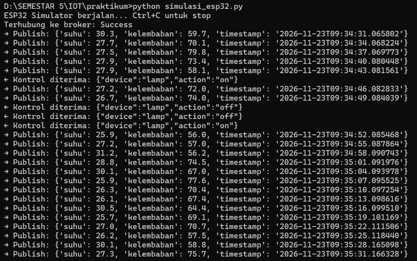 |
| MQTT -> Node-RED | Debug panel Node-RED menampilkan data sensor | 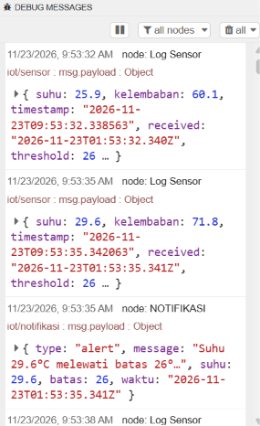 |
| Node-RED -> REST | `curl` ke `/api/suhu` mengembalikan JSON | 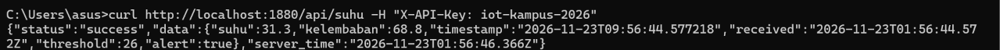 |
| REST -> Web | Dashboard menampilkan angka berubah | 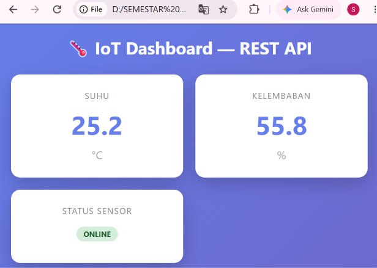 |
| Web -> REST -> MQTT | Klik tombol, simulator menerima perintah | 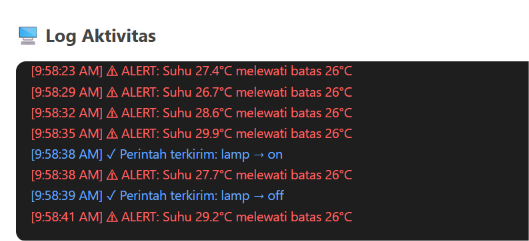 |

## Tugas Pengembangan (Nilai Tambah)

### 1. Endpoint `PUT /api/threshold` dan notifikasi
Batas suhu disimpan di flow context lewat `PUT /api/threshold`. Setiap data sensor dibandingkan dengan batas tersebut. Jika suhu melewati batas, Node-RED mengirim notifikasi ke topik MQTT `iot/notifikasi`, ke debug panel, dan dashboard menampilkan log `ALERT`.

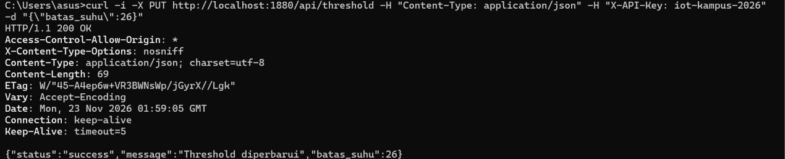
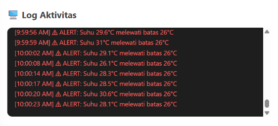

### 2. Grafik real-time Chart.js
Dashboard menampilkan grafik garis suhu dan kelembaban (20 data terakhir) yang bergerak tiap data baru masuk.

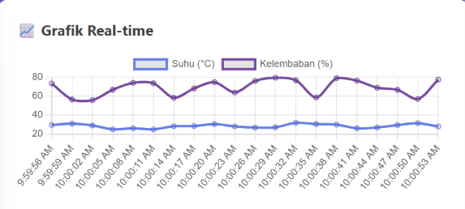

### 3. Autentikasi API key
Setiap endpoint REST mengecek header `X-API-Key`. Tanpa key atau dengan key salah, server membalas `401`.

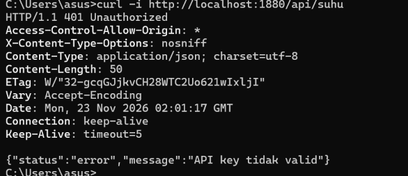
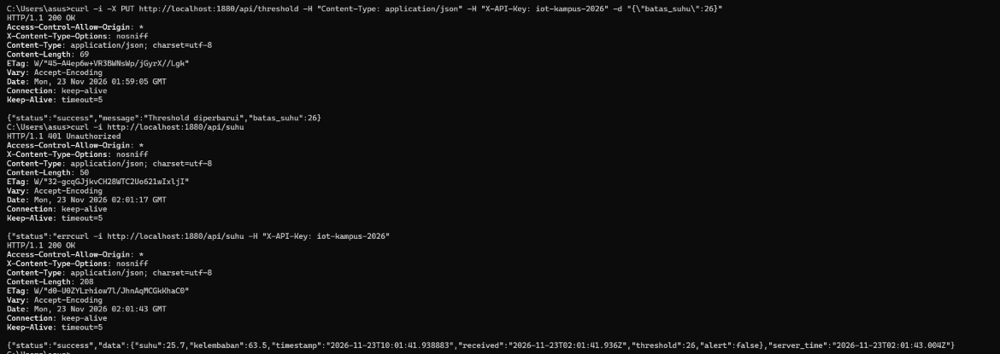

### 4. WebSocket
Node `websocket out` pada path `/ws/sensor` mengirim data sensor ke dashboard. Dashboard memperbarui angka, tabel, dan grafik tanpa polling, serta menyambung ulang otomatis jika koneksi terputus.

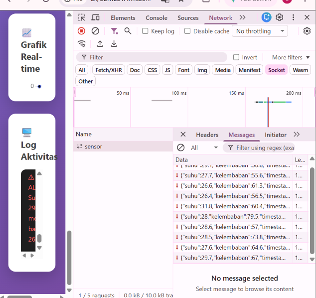

### 5. Penyimpanan history ke SQLite
Setiap data sensor disimpan ke `iot.db` lewat node SQLite. Endpoint `/api/history` membaca dari database, bukan dari flow context, sehingga data tetap ada setelah Node-RED di-restart.

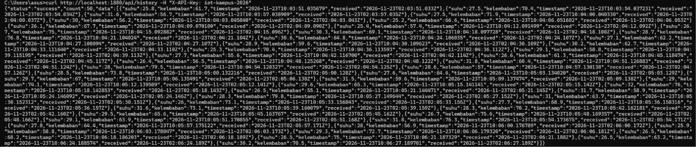

## Contoh Perintah curl

```
curl http://localhost:1880/api/suhu -H "X-API-Key: <API_KEY>"
curl http://localhost:1880/api/history -H "X-API-Key: <API_KEY>"
curl -X POST http://localhost:1880/api/kontrol -H "Content-Type: application/json" -H "X-API-Key: <API_KEY>" -d "{\"device\":\"lamp\",\"action\":\"on\"}"
curl -X PUT http://localhost:1880/api/threshold -H "Content-Type: application/json" -H "X-API-Key: <API_KEY>" -d "{\"batas_suhu\":28}"
```

## Catatan Penyesuaian

- `paho-mqtt` versi 2 memakai `mqtt.CallbackAPIVersion.VERSION2` pada `mqtt.Client(...)`.
- Di Node-RED v5, CORS diaktifkan lewat `httpNodeCors` di `settings.js` (lihat `settings-contoh.txt`), karena node `OPTIONS /api/*` tidak menangani preflight.
- Endpoint WebSocket tidak memakai API key, karena browser tidak dapat mengirim header kustom pada koneksi WebSocket.
- Simulator juga subscribe ke `iot/kontrol` agar perintah dari dashboard dapat diverifikasi di terminal.
- File `iot.db` dibuat otomatis oleh flow dan tidak disertakan di repo (lihat `.gitignore`).
